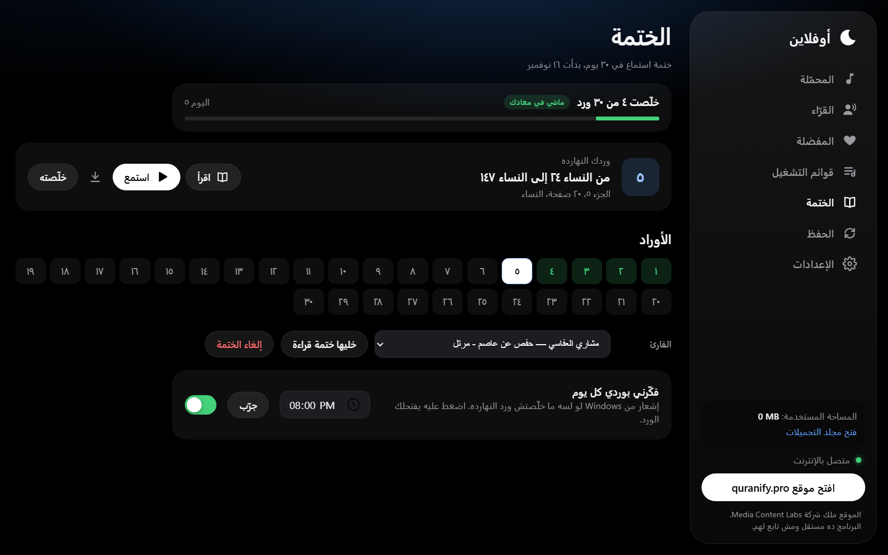
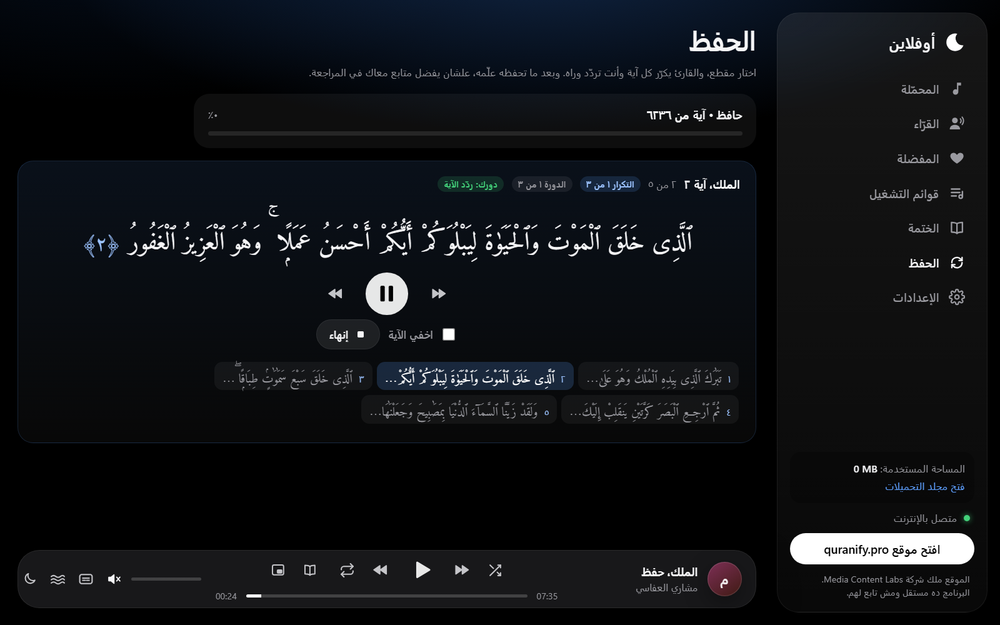
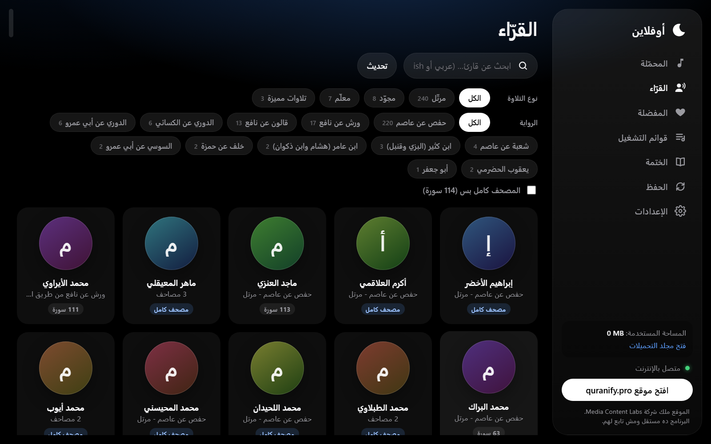
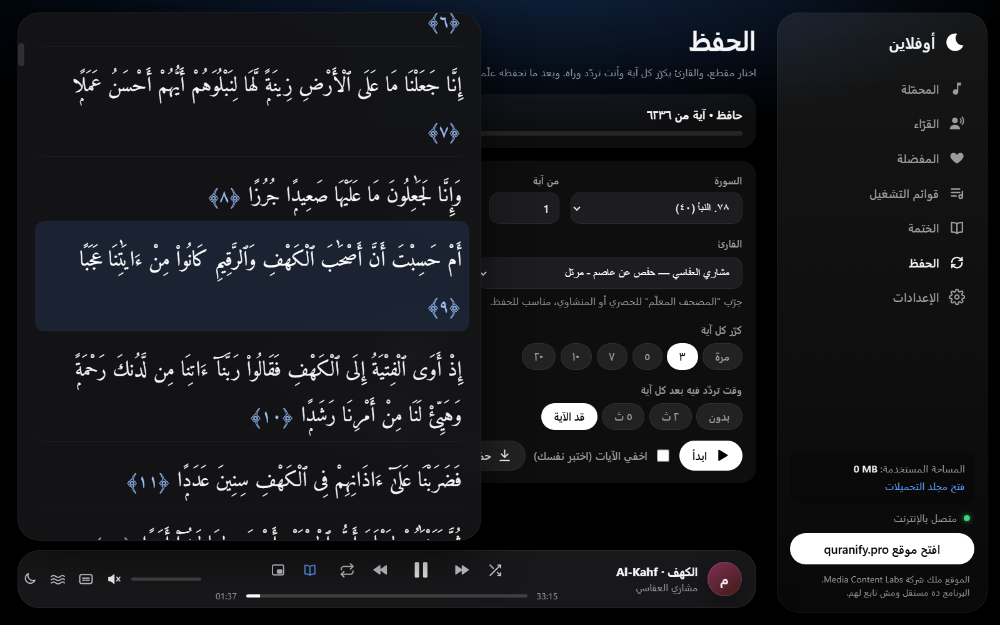

# Quranify Desktop

> **English:** A free, open-source, ~2 MB Windows app for listening to the Quran: 244 reciters
> with all their riwayat (from mp3quran.net), offline downloads, the Mushaf text with tafsir,
> a khatma planner with daily reminders, a memorization trainer, a tray icon, global hotkeys and
> a mini player. It uses ~35–50 MB of RAM while waiting in the tray. It can also show the
> quranify.pro website in its own window. **Not affiliated with quranify.pro or Media Content Labs.**
> No ads, no tracking.

برنامج Windows مجاني ومفتوح المصدر، حجمه حوالي 2 MB، ومكتوب بـ Rust. فيه حاجتين:

1. **وضع أوفلاين مستقل** فيه 244 قارئ بكل رواياتهم من mp3quran.net. تنزّل وتسمع من غير نت، ومعاه نص المصحف والتفسير، والختمة، والحفظ.
2. **موقع quranify.pro** في نافذة خاصة بيه لو تحب، من غير شريط المتصفح.

بيستخدم WebView2 الموجود أصلًا في Windows 10 و11. مفيهوش إعلانات، ومش بيجمع أي بيانات عنك.

> البرنامج مستقل، ومش تابع لموقع quranify.pro ولا للشركة المالكة له (Media Content Labs, LLC).

| الختمة | الحفظ |
|---|---|
|  |  |
| **القرّاء** | **النص مع التلاوة** |
|  |  |

---

## التسطيب

1. نزّل `Quranify-Setup.exe` من صفحة [Releases](../../releases/latest).
2. شغّله واضغط "نعم".
3. لو ظهرت رسالة **"Windows protected your PC"** اضغط **More info** وبعدين **Run anyway**. الرسالة دي بتظهر لأي برنامج جديد لسه مش موقّع بشهادة مدفوعة. الكود كله موجود هنا، وتقدر تتأكد من الملف بالـ SHA256 اللي في صفحة الإصدار.
4. لو جهازك ناقصه WebView2 (نادر، في بعض نسخ Windows 10)، البرنامج هيقولك ويفتحلك صفحة تحميله من Microsoft.

فيه كمان نسخة محمولة (`Quranify-portable.zip`) تشتغل من غير تسطيب.

تفاصيل المسطّب، لو بتشغّله من الكود (`dist/Quranify-Setup.exe`):
- بيتسطّب في `%LOCALAPPDATA%\Programs\Quranify` من غير صلاحيات أدمن.
- بيعمل اختصار في قائمة ابدأ وعلى سطح المكتب.
- بيظهر في **الإعدادات ← التطبيقات المثبتة**، وتقدر تشيله من هناك. وأنت بتشيله بيسألك تمسح التحميلات وتسجيل الدخول ولا تسيبهم.
- لو شغّلته وهو متسطّب قبل كده، بيحدّثه ويحتفظ بكل بياناتك.

أو شغّل `dist/Quranify.exe` على طول من غير تسطيب.

---

## الموقع

- تسجيل الدخول بيتحفظ، والبرنامج بيستنى يحفظ بيانات الموقع قبل ما يقفل.
- البرنامج بيفتح على الأوفلاين، والموقع من زرار "افتح موقع quranify.pro". ولو تحب يفتح على الموقع على طول، غيّرها من **الإعدادات ← يفتح على**.
- الموقع بيفتح على **آخر صفحة كنت فاتحها**.
- لينكات الموقع اللي بتطلب تبويب جديد (Help، Premium…) بتفتح جوه نفس النافذة. واللينكات الخارجية بتفتح في متصفحك.
- اختصارات المتصفح: Alt+← رجوع، F5 تحديث، Ctrl+F بحث.
- زرار **أوفلاين** صغير فوق في الركن (أو Ctrl+O). ولو النت قطع البرنامج بيحوّل للأوفلاين لوحده.

## وضع الأوفلاين

- **القرّاء:** 244 قارئ، وتقدر تفلترهم بـ:
  - **نوع التلاوة:** مرتّل، مجوّد، معلّم، تلاوات مميزة.
  - **الرواية:** حفص، ورش، قالون، الدوري، شعبة، السوسي، ابن كثير، ابن عامر، خلف، يعقوب، أبو جعفر.
  - **المصحف كامل بس** (114 سورة).
- **التحميل:**
  - سورة سورة أو المصحف كله.
  - **بيكمّل من نفس النقطة** لو قفلت البرنامج أو النت قطع.
  - تقدر تغيّر مكان التحميل من الإعدادات، والملفات القديمة بتتنقل معاه.
- **المفضلة:** قرّاء وسور، بزرار القلب.
- **قوائم التشغيل:** قوائمك الخاصة، تخلط فيها سور من قرّاء مختلفين. ومعاها **قوائم جاهزة**: قبل النوم، للمذاكرة والتركيز، الرقية الشرعية، قصار السور، سورة الكهف.
- **يكمّل من مكانك:** في السور الطويلة بيفتكر وقفت فين.
- **نص المصحف** بالرسم العثماني، ومعاه التفسير الميسر والترجمة الإنجليزية.
  - النص بيتحفظ على الجهاز، وفيه زرار "تحميل النص كله" في الإعدادات.
  - **الآية اللي بتتقري بتنوّر** في النص، وتضغط على أي آية فالتلاوة تروح لها. ده متاح لـ 115 تلاوة.
- **الآيات مع التلاوة (زي الترجمة في الأفلام):** الآية الحالية بتظهر فوق المشغّل ومعاها التفسير أو الترجمة لو تحب. زرار ▭ في المشغّل.
- **أصوات هادية:** مطر، بحر، رياح، نار. متولّدة بالكود، فمش محتاجة ملفات ولا نت، وكل صوت ليه مستوى لوحده.
- **مؤقّت النوم:** 15 / 30 / 45 / 60 / 90 دقيقة أو آخر السورة. الصوت بيهدى بالتدريج. موجود كمان في قائمة الأيقونة اللي جنب الساعة، وده بيشغّله على الموقع برضه.
- **يوم الجمعة:** تذكير بسورة الكهف، وتسمعها أو تقراها بضغطة.

## الختمة

- **بتقسّم المصحف على عدد أيام تختاره:** ٣ أيام، أسبوع، ١٠، ١٥، ٢٠ يوم، شهر، شهرين، ٣ شهور، سنة، أو أي عدد من ٣ لـ ٦٠٤.
- **التقسيم على حدود معروفة:** الشهر بالأجزاء، والأسبوع بالأحزاب السبعة (المنازل)، والتقسيمات التانية بأرباع الأحزاب لو العدد بيقبل، وإلا بصفحات مصحف المدينة.
- **كل يوم يطلعلك وردك:** من آية كذا لآية كذا، ورقم الجزء، وعدد الصفحات. الورد بيظهر كمان في صفحة "المحمّلة".
  - **اقرأ:** الورد بيتفتح في لوحة النص حتى لو بيعدّي على أكتر من سورة، ومعاه التفسير والترجمة لو تحب.
  - **استمع:** التلاوة بتبدأ من أول آية في الورد وبتقف عند آخر آية بالظبط. ده متاح للقرّاء اللي عندهم توقيت آيات (١١٥ تلاوة). ولما الورد يخلص بيتعلّم لوحده إنه خلص.
  - زرار لتحميل سور الورد للأوفلاين.
- **بيتابع معاك:** فين وصلت، وإذا كنت ماشي في معادك ولا متأخر. ولو اتأخرت، بيطلعلك أول ورد لسه ما خلّصتوش. ولما تختم بيبدأ ختمة جديدة بنفس الخطة لو تحب، وبيعدّ مرات الختم.
- **تذكير كل يوم:** إشعار من Windows في المعاد اللي تختاره (الافتراضي ٨ بالليل)، بس لو لسه ما خلّصتش ورد النهارده. الإشعار فيه الورد، ولو عليك أوراد متأخرة بيقولك عددها. اضغط عليه يفتحلك صفحة الختمة. لو الجهاز كان مقفول وقت التذكير، بيظهر أول ما تفتحه في نفس اليوم، ومرة واحدة بس في اليوم. ومعاه زرار "جرّب" وتقدر تقفله، من صفحة الختمة.
- **من الأيقونة اللي جنب الساعة:** "ورد الختمة" بيفتح صفحة الختمة على طول.

## الحفظ

- **تختار مقطع:** سورة ومن آية لآية، والقارئ.
- **التكرار:**
  - كل آية تتكرّر ١ أو ٣ أو ٥ أو ٧ أو ١٠ أو ٢٠ مرة.
  - المقطع كله يتكرّر مرة أو ٣ أو ٥ أو على طول.
- **وقت تردّد فيه:** بعد كل آية التلاوة بتسكت وقت تردّد فيه: ٢ ثانية، أو ٥، أو قد الآية نفسها.
- **السرعة:** ٠٫٧٥× أو ١× أو ١٫٢٥×.
- **اختبر نفسك:** الآيات ممكن تستخبى، وتعدّي عليها بالماوس علشان تشوفها.
- **التحكم:** الآية الحالية بتظهر بخط كبير، ومعاها رقم التكرار والدورة. وتقدر تروح لأي آية في المقطع بضغطة.
- **محفوظاتك:** بعد ما تخلّص المقطع، علّمه إنه محفوظ. بيظهرلك كام آية حافظ من ٦٢٣٦، وكل سورة وآخر مرة راجعتها، وزرار "راجع". والسورة اللي ما راجعتهاش من أسبوع بيظهر جنبها "محتاجة مراجعة".
- **الإيقاف التلقائي:** شغّال هنا كمان. لو قفلت الجهاز وأنت بتردّد، بيكمّل من أول نفس الآية.

## إيقاف تلقائي

كل حالة ليها مفتاح في الإعدادات، وكلها شغّالة افتراضيًا. بيشتغل مع الموقع ومع الأوفلاين.

- **لما تقفل الجهاز (Win+L):** التلاوة بتقف، ولما تفتح الجهاز بتكمّل من نفس المكان.
- **لما الجهاز ينام:** التلاوة بتقف.
- **لما مخرج الصوت يتغيّر:** مثلًا لو السماعة اتشالت، علشان التلاوة ما تطلعش فجأة من سماعات الجهاز.
- **لما برنامج تاني يستخدم المايك:** زي Zoom أو Teams أو Discord أو WhatsApp. التلاوة بتقف وبتكمّل لما المكالمة تخلص.

لو أنت اللي وقّفت التلاوة بنفسك، مش هتكمّل لوحدها. والكشف ده مش بيشتغل غير والصوت شغّال، أو لما البرنامج يكون هو اللي وقّف، فمش بياخد موارد غير كده.

`Quranify.exe --diag` بيكتب في `%LOCALAPPDATA%\QuranifyDesktop\diag.txt` مخرج الصوت الحالي، وهل فيه برنامج بيستخدم المايك.

## من أي مكان

- **أيقونة جنب الساعة:** إظهار، تشغيل/إيقاف، التالية، السابقة، مؤقّت النوم، المشغّل الصغير، ورد الختمة، الأوفلاين، خروج.
- **قفل النافذة بيخلّي البرنامج شغّال جنب الساعة** والصوت مكمّل. ممكن تقفل الخاصية دي من الإعدادات.
- **المشغّل الصغير:** شباك صغير فوق كل البرامج، فيه السورة والقارئ والتحكم والتقديم. شغّال مع الموقع ومع الأوفلاين، وتسحبه لأي مكان.
- **اختصارات Windows** (بتشتغل حتى لو البرنامج مستخبي):

  | الاختصار | الوظيفة |
  |---|---|
  | Ctrl+Alt+Space | تشغيل / إيقاف |
  | Ctrl+Alt+→ | السورة التالية |
  | Ctrl+Alt+← | السورة السابقة |
  | Ctrl+Alt+M | المشغّل الصغير |

- **نسخة واحدة بس:** لو فتحته وهو مفتوح، بيظهر نفس الشباك بدل ما يفتح نسخة تانية (فالصوت مش هيطلع مرتين).
- **يشتغل مع Windows:** من الإعدادات، ويفضل مستخبي جنب الساعة.

## خفيف على الجهاز (أرقام اتقاست على جهازك)

| الحالة | ذاكرة فعلية (Working set) | المعالج |
|---|---|---|
| النافذة مفتوحة على الموقع | ~500 MB | ~0.5% |
| مستخبي جنب الساعة (أول 30 ثانية) | ~340 MB | 0% |
| **مستخبي ومفيش حاجة شغّالة (بعد 30 ثانية)** | **~35–50 MB** | **0%** |

- لما يستخبى أو يتصغّر بيوقف الرسم ويطلب من WebView2 يقلل الذاكرة.
- لو مفيش حاجة شغّالة بعد 30 ثانية بيـ"نوّم" الصفحة خالص، ولما تفتحه بتصحى لوحدها.
- الرسم على المعالج بدل كارت الشاشة بيوفّر حوالي نص الذاكرة. ممكن تشغّل كارت الشاشة من الإعدادات.
- المشغّل الصغير مش بيتعمل غير لما تفتحه، وبيتشال من الذاكرة لما تقفله.

## أوامر سطر الأوامر

| الأمر | الوظيفة |
|---|---|
| `Quranify.exe --offline` | يفتح على الأوفلاين |
| `Quranify.exe --quit` | يقفل النسخة الشغّالة بأمان |
| `Quranify.exe --uninstall` | إزالة البرنامج |
| `Quranify-Setup.exe --quiet` | تسطيب من غير أسئلة |

## مكان البيانات

`%LOCALAPPDATA%\QuranifyDesktop` وفيه (لو البرنامج قفل فجأة بيكتب السبب في `crash.txt`، ابعته في [Issues](../../issues)):
- `WebView2`: تسجيل الدخول وبيانات الموقع.
- `offline`: السور المحمّلة (أو المكان اللي اخترته).
- `text`: النص المحفوظ.
- `timing`: توقيتات الآيات.
- `user.json`: المفضلة والقوائم والختمة والمحفوظات.
- `settings.json`: الإعدادات.
- `queue.json`: التحميلات اللي لسه ما خلصتش.
- `reminded.txt`: آخر يوم ظهر فيه تذكير الختمة.

## البناء من الكود

محتاج Rust (`rustup`) و Visual Studio Build Tools (C++).

```powershell
powershell -ExecutionPolicy Bypass -File .\build-release.ps1
```

بيطلع `dist\Quranify.exe` و`dist\Quranify-Setup.exe`. السكربت بيستخدم مجلد بناء بمسار قصير، علشان حد طول المسارات في Windows.

## المصادر والتراخيص

- **التلاوات وتوقيتات الآيات:** [mp3quran.net](https://mp3quran.net)
- **نص المصحف والتفسير الميسر والترجمة (Sahih International)، وحدود الصفحات والأجزاء والأحزاب:** [alquran.cloud](https://alquran.cloud)
- **خط المصحف:** Amiri Quran، رخصة SIL Open Font License.
- **أيقونة البرنامج:** هلال بسيط اتعمل للبرنامج، مش لوجو الموقع.

البرنامج مش تابع لـ Quranify ولا للشركة المالكة (Media Content Labs). الموقع بيتعرض زي ما تفتحه في أي متصفح. وضع الأوفلاين مبني بالكامل على مصادر مفتوحة ومش بيستخدم أي محتوى أو API خاص بالموقع. ميزة التحميل اللي جوه Quranify نفسه مدفوعة وفي تطبيقات الموبايل بس، والبرنامج مش بيلمسها.
